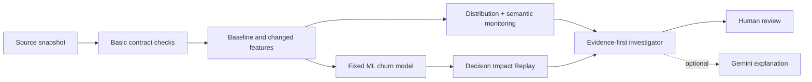

# DataPulse AI — Data-to-Decision Impact Replay

> **What if every basic pipeline check passes, but an upstream field quietly changes meaning and causes your ML model to change business decisions?**

A reproducible Python / ML engineering project that traces a **semantic data failure** from an apparently healthy source dataset to model predictions and a decision-level incident report. Built as a standalone project inside the AEGIS repository; it does not overwrite AEGIS.

[](https://colab.research.google.com/github/Codewithadi21/aegis-real-time-supply-chain-ai/blob/main/datapulse-ai/notebooks/DataPulse_AI_Colab.ipynb)

## Problem
The column `engagement_events_30d` used to count purchases. A producer switches the definition to login events but keeps its name, type and non-null behavior. The data pipeline passes basic schema checks, yet a pre-trained churn-risk model interprets logins as purchase activity. Traditional "pipeline succeeded" monitoring may miss the resulting model decision shifts.

## What this implementation demonstrates
- Synthetic customer event data and an explicitly documented **semantic data contract**.
- Conventional schema/type/uniqueness checks, plus formatting/whitespace/duplicate fault handling.
- Statistical input change monitoring (`PSI`, KS statistic) with caution about interpreting drift.
- Fixed-model, same-cohort, paired replay that shows how many predictions and high-risk flags change.
- Evaluation against synthetic known churn labels (AUC, recall, false negatives) rather than claiming drift automatically equals harm.
- Evidence-first incident report and manually declared field → feature → model → decision lineage.
- Optional BigQuery upload, Pub/Sub incident-event publishing, and private Gemini explanation.

## Verified locally
The default CLI and automated tests are designed to run offline. **Live GCP deployment and production-scale performance are not claimed.** Metrics come from seeded synthetic data, not real company customers.

## Run locally
```bash
cd datapulse-ai  # if running from the AEGIS repository root
python -m pip install -r requirements.txt
python -m pytest -q
python -m datapulse --rows 5000
```
Expected outputs (ignored by Git):
```text
artifacts/replay_summary.json
artifacts/incident_report.json
artifacts/prediction_replay.csv
```

## Day 1 — Colab (no GCP costs)
[**Launch notebook**](https://colab.research.google.com/github/Codewithadi21/aegis-real-time-supply-chain-ai/blob/main/datapulse-ai/notebooks/DataPulse_AI_Colab.ipynb)

## Day 2 — Optional Google Cloud integration
See [GCP and Colab instructions](docs/GCP_COLAB_GUIDE.md). BigQuery and Pub/Sub may use free-tier allowances or credits. No service account keys are required in the repo.

## Architecture


## What we measure
- How much the `engagement_events_30d` distribution changed.
- Whether the **basic** input checks still pass.
- Whether the **semantic** data contract fails.
- How many predictions flip under identical cohort/model conditions.
- Whether labeled ML metrics change (when synthetic labels are available).

## Engineering honesty and limitations
- A fixed-model replay demonstrates **sensitivity to a source change**; it does **not prove causation or actual business loss**.
- Synthetic data are designed to make this failure mode visible.
- Feature drift can be benign. Do not automatically quarantine all distribution changes.
- Incident diagnostics propose actions requiring approval; they never change production data.
- This is an educational portfolio prototype. It is not a vendor replacement or proven enterprise-wide observability platform.

More: [business brief](docs/PROJECT_BRIEF.md) · [architecture decisions](docs/ARCHITECTURE.md) · [interview guide](docs/INTERVIEW_GUIDE.md).

## Security
Never commit production data, OAuth tokens, API keys, or service-account key files. `.gitignore` excludes `.env`, artifacts, and credential-like filenames.

## Free local LLM — no Gemini billing required
Run the independent [DataPulse Local AI Colab notebook](notebooks/DataPulse_Local_AI_Colab.ipynb) to explain the **real** DataPulse incident report using the open-weight [Qwen2.5-1.5B-Instruct](https://huggingface.co/Qwen/Qwen2.5-1.5B-Instruct) model. This integration uses a local `datapulse/local_llm.py` adapter and `requirements-local-llm.txt`: no Gemini API key, Vertex AI account, or model API billing required. Free Colab GPU availability is limited and model weights download on first run. The original, deterministic investigator remains authoritative; the LLM adds a reviewable explanation, not a proven root cause or autonomous remediation. The new code is committed, but **live model inference in the user's Colab is not yet verified**.

## DataPulse Guide AI — project tutor + incident investigation
The [Guide AI Colab notebook](notebooks/DataPulse_Guide_AI_Colab.ipynb) demonstrates two grounded assistant modes: (1) explaining how DataPulse works from checked-in project documentation and (2) analyzing the verified synthetic incident report. `datapulse/guide_assistant.py` uses local **TF-IDF source retrieval**, optional local Qwen generation, explicit source paths, and a retrieval-only fallback. Read [the user guide](docs/DATAPULSE_USER_GUIDE.md). This is not a trained-from-scratch LLM, true vector embedding RAG, an autonomous repair agent, or a Vertex AI deployment. GitHub code is committed; user-side Colab LLM inference remains to be validated.

## Final completion route — DataPulse end-to-end verification
Start with the [**Final End-to-End Colab Notebook**](notebooks/DataPulse_Final_End_to_End_Colab.ipynb). It performs:
1. Fresh GitHub pull, tests, deterministic synthetic replay and incident report.
2. No-API-key project-guide retrieval, with source documents.
3. Optional BigQuery upload and SQL verification using your own authenticated GCP trial project.
4. **NEW:** Pub/Sub topic **and subscription setup before publishing**, publish one incident, consume/validate it, append to `datapulse_ai.incident_events` and acknowledge after a successful BigQuery load.
5. Final SQL verification of incident rows and a portfolio screenshot checklist.

Cloud commands (run from `datapulse-ai/` with authenticated Google user and APIs enabled):
```bash
python -m cloud.bigquery_load --project-id YOUR_PROJECT_ID
python -m cloud.incident_consumer --project-id YOUR_PROJECT_ID --setup-only
python -m cloud.pubsub_demo --project-id YOUR_PROJECT_ID
python -m cloud.incident_consumer --project-id YOUR_PROJECT_ID
```
For local-only use run `python -m pytest -q` and `python -m datapulse --rows 5000`. There is no Gemini or Vertex AI requirement to finish the project. Qwen local LLM remains an optional companion notebook. **The new cloud consumer is a single-message demonstration, not a continuously hosted subscriber.** Delivery is at least once and BigQuery may accumulate duplicates during retries; production would require a long-running worker, dead-letter queue, idempotent ingestion and monitoring. GCP execution and local full-suite results must be verified in the user's Colab and are not implied by code existing on GitHub.

## Final read-only acceptance check
After authenticating inside Colab and installing `requirements-gcp.txt`, run:
```bash
python -m cloud.final_audit --project-id YOUR_PROJECT_ID
```
The audit checks current local tests and replay artifacts, cloud table contents, real prediction flips, stored incident-message IDs, Pub/Sub topic, and subscription-to-topic linkage. It generates missing **local synthetic** replay artifacts but **does not create, publish, consume or alter cloud resources**. BigQuery read queries can incur small eligible charges. The audit saves `artifacts/final_audit.json` and prints `DATAPULSE ONE-SHOT PORTFOLIO DEMO: VERIFIED` only when all assertions pass. Capture the output to document actual end-to-end execution. This validates the one-shot demo, not a production-grade continuously running data platform.

## Showcase portfolio
A public-facing [DataPulse portfolio case-study webpage](portfolio/index.html) presents the problem, architecture, reproducible synthetic results, industry relevance, test evidence and a concise interview pitch. The page is standalone HTML; GitHub Pages needs to be enabled by the repository owner to publish it as a browsable website. The HTML itself makes no live GCP verification claims.
