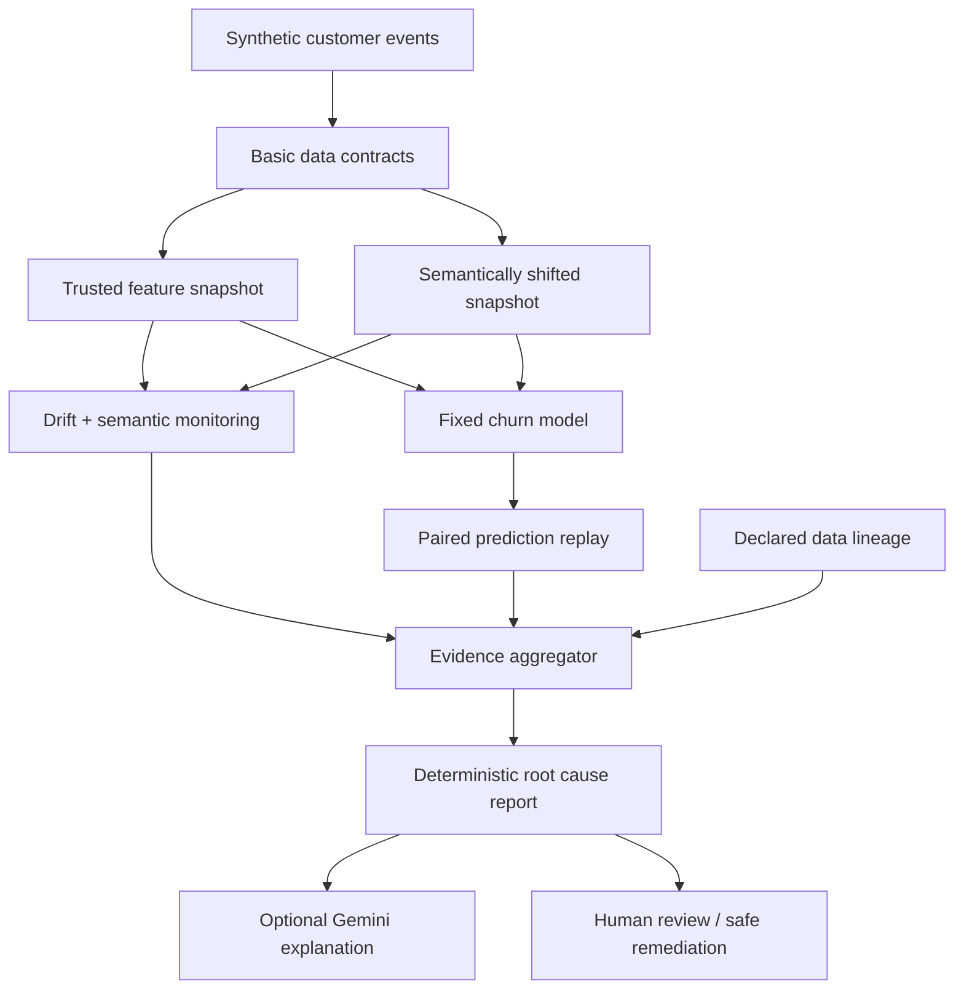

# Architecture and design decisions

## Why use a fixed model?
To isolate data input changes from retraining variability. Training on the trusted cohort and comparing predictions on identical holdout IDs avoids a misleading comparison across customer populations.

## Why report BOTH schema validity and semantic validity?
A column with integer values can be valid at the type level while violating its business meaning. We use a second trusted `purchases_30d` field as a synthetic demonstration of a semantic reference; in real pipelines this reference may not exist.

## Tradeoffs
- `PSI` and `KS` flag distribution change but do not prove adverse impact.
- A replay with historical labels enables offline evaluation; live production labels may arrive weeks later.
- The synthetic generator intentionally makes the model depend on engagement counts; metrics must not be generalized to enterprise data.
- An LLM can explain a verified incident but must not invent metrics, causal certainty, or remediation commands.
- Optional Pub/Sub demonstration publishes a one-shot incident event; for reliable always-on operations, add a managed consumer, IAM and observability.

## How this maps to Google DAS skills
Reliable data contracts, scalable analytical schema, Python/SQL, AI-ready feature engineering, model evaluation, GCP BigQuery, optional Pub/Sub integration, evidence-based stakeholder communications.
