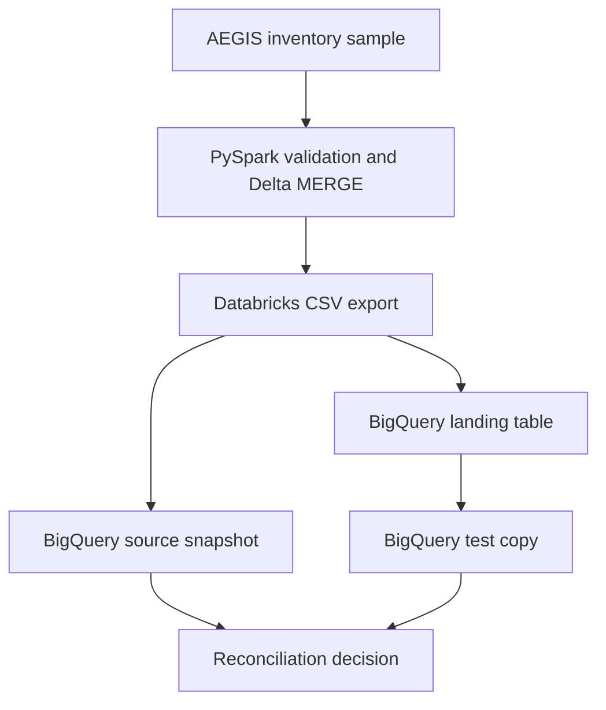

# AEGIS inventory migration from Databricks to BigQuery

Can the warehouse team switch its inventory dashboard to BigQuery and keep the same stockout decisions? This one-table demo uses the [12 inventory positions already in AEGIS](../../data/samples/inventory.csv). The alert rule is **stock quantity below 5**.



## Day 1 · Build and migrate one table

1. Clone the AEGIS branch containing this folder using Databricks Git folders. Open [01_inventory_delta.py](01_inventory_delta.py) as a Databricks source notebook on Python compute with Delta access. Set the catalog and schema widgets to a writable scratch schema. The default CSV path is relative to the notebook folder. If needed, set the widget to the absolute workspace path of `data/samples/inventory.csv`.
2. Run all notebook cells. Batch 1 drops one exact duplicate. Batch 2 updates Noida’s `LAPTOP_001` from 35 to 4 and ignores an older update to `PHONE_001`. The notebook reruns batch 2 and asserts that all stored values are identical. Record the printed Delta table name and assertion output.
3. Download all 12 rows from the final Databricks result as CSV and name the file `inventory_snapshot.csv`. In BigQuery Studio, create a dedicated dataset named `aegis_migration` in your chosen location in a billing-enabled project. Use **Create table → Upload → CSV**. Upload the same file in two separate load jobs, first to `inventory_source_snapshot`, then to `inventory_landing`. Turn off autodetect and skip one header row. Enter this schema as text, or define the same fields in this order with mode **REQUIRED**.

```text
warehouse_id:STRING:REQUIRED,product_id:STRING:REQUIRED,stock_qty:INTEGER:REQUIRED,updated_at:TIMESTAMP:REQUIRED,stockout_flag:BOOLEAN:REQUIRED
```

The transfer method for this demo is a browser download from Databricks followed by local CSV uploads to BigQuery. Keep the exported file, load job IDs and row counts as evidence. The reference table stays fixed during the stale injection and correction. Before repeating the full experiment, use a clean scratch dataset or explicitly refresh both CSV loads from the same new export.

## Day 2 · Demonstrate HOLD, correct, verify PASS

Replace `YOUR_PROJECT_ID` in all SQL with your GCP project ID. Run in BigQuery Studio in dataset location using GoogleSQL. The UPDATE and MERGE require a billing-enabled project.

1. Run [02_prepare_stale_copy.sql](02_prepare_stale_copy.sql). The test copy now has an old timestamp and 12 units for Noida’s `LAPTOP_001`.
2. Run [03_reconciliation.sql](03_reconciliation.sql). Run the following statement separately to save the report before repair.
3. Query the saved table with `SELECT * FROM ...` in the editor using its full table name. Choose **Save results → Local download → CSV** and save `hold.csv`.

```sql
CREATE OR REPLACE TABLE `YOUR_PROJECT_ID.aegis_migration.reconciliation_hold` AS
SELECT * FROM `YOUR_PROJECT_ID.aegis_migration.inventory_reconciliation`;
```

4. Run [04_correct_record.sql](04_correct_record.sql). The MERGE copies the correct quantity and timestamp for the affected key from the reference.
5. Run the following statement, query the saved table, and download `pass.csv`. Keep both CSVs and the BigQuery query job IDs for review.

```sql
CREATE OR REPLACE TABLE `YOUR_PROJECT_ID.aegis_migration.reconciliation_pass` AS
SELECT * FROM `YOUR_PROJECT_ID.aegis_migration.inventory_reconciliation`;
```

## Expected results

| Check | Stale copy | Corrected copy |
|---|---:|---:|
| Source and target row counts | 12 / 12 | 12 / 12 |
| Missing keys | 0 | 0 |
| Invalid or duplicate keys | 0 | 0 |
| Quantity mismatches | 1 | 0 |
| Timestamp mismatches | 1 | 0 |
| Stockout flag mismatches | 1 | 0 |
| Warehouse total mismatches | 1 | 0 |
| Decision | HOLD | PASS |

The HOLD row identifies `WH_IND_01 / LAPTOP_001`. Databricks shows **4 units, alert on**. The BigQuery test copy shows **12 units, alert off**. Noida's totals are **731** and **739** respectively. After the reload the same snapshot passes all checks. PASS supports switching the demo dashboard because the inventory and derived alert decisions agree for every key in the tested snapshot.

## Execution evidence

Repository sample and reconciliation logic checked locally. Record cloud evidence here after execution.

| Evidence | Value to record |
|---|---|
| Databricks run | Table name and batch replay output |
| BigQuery CSV loads | Jobs and row counts |
| HOLD | Query job ID and `hold.csv` |
| PASS | Query job ID and `pass.csv` |

For the interview, explain why row counts and keys match in both states, how strict event-time ordering makes the Delta replay idempotent, and which reconciliation checks protect the stockout decision.
